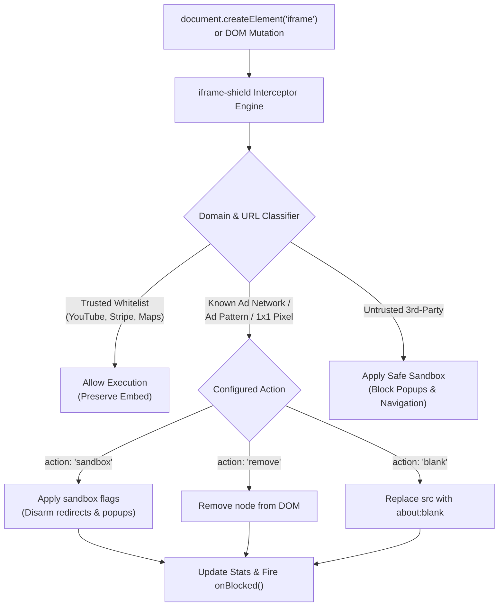

> [!NOTE]
> **Production-Ready Client-Side Ad Shield:** Protect your web application and its visitors from rogue iframe ads, malicious popunders, and clickjacking without requiring users to install third-party browser extensions.

<div align="center">

# 🛡️ iframe-shield

### Autonomous, client-side iframe ad & popup blocker SDK for web applications.

<p>
  <strong>Developed by <a href="https://github.com/jojin1709">JOJIN JOHN</a></strong>
</p>

<p>
  <a href="https://github.com/jojin1709/iframe-shield/actions"></a>
  <a href="https://opensource.org/licenses/MIT"></a>
  <a href="https://workers.cloudflare.com"></a>
  <a href="#"></a>
  <a href="#"></a>
</p>

It intercepts DOM iframe creations before they execute, evaluates domains against threat heuristics, and neutralizes rogue ads and popups on the fly. **No ads, zero breaking changes.**

**This repository is iframe-shield: the lightweight (< 4KB) open-source developer SDK.**

<p><strong>Add to your website</strong></p>

```html
<script src="https://cdn.jsdelivr.net/npm/iframe-shield/dist/iframe-shield.min.js"></script>
```

<sub>Drop-in CDN script tag auto-initializes with zero configuration required.</sub>

---

<p>
  <a href="#quick-start"><strong>Quick Start</strong></a> &bull;
  <a href="https://jojin1709.github.io/iframe-shield/docs/"><strong>Swagger API Docs</strong></a> &bull;
  <a href="#key-capabilities"><strong>Key Capabilities</strong></a> &bull;
  <a href="#architecture"><strong>Architecture</strong></a> &bull;
  <a href="#configuration"><strong>Configuration</strong></a> &bull;
  <a href="#interactive-playground"><strong>Playground</strong></a> &bull;
  <a href="#common-questions"><strong>FAQ</strong></a>
</p>

---

</div>

> [!TIP]
> **Using a modern bundler?** Install via npm: `npm install iframe-shield` and import `{ IframeShield } from 'iframe-shield'`. Full TypeScript and modern ESM/CommonJS modules are supported out of the box.

## Table of Contents

- [Table of Contents](#table-of-contents)
- [What is iframe-shield?](#what-is-iframe-shield)
  - [Why iframe-shield Exists](#why-iframe-shield-exists)
  - [How It Differs from Browser Extensions](#how-it-differs-from-browser-extensions)
  - [Preserves Legitimate Third-Party Embeds](#preserves-legitimate-third-party-embeds)
- [Quick Start](#quick-start)
  - [Option 1: Drop-in Script Tag (CDN)](#option-1-drop-in-script-tag-cdn)
  - [Option 2: npm / Modern Bundlers](#option-2-npm--modern-bundlers)
  - [Option 3: Cloudflare Edge Worker](#option-3-cloudflare-edge-worker)
- [Key Capabilities](#key-capabilities)
- [Architecture](#architecture)
- [Configuration](#configuration)
  - [Options Reference](#options-reference)
  - [API Methods](#api-methods)
- [Interactive Playground](#interactive-playground)
- [Testing and Verification](#testing-and-verification)
- [Common Questions](#common-questions)
  - [Does this break legitimate embeds like YouTube or Stripe?](#does-this-break-legitimate-embeds-like-youtube-or-stripe)
  - [How does safe sandboxing work?](#how-does-safe-sandboxing-work)
  - [Can I dynamically whitelist or blacklist domains at runtime?](#can-i-dynamically-whitelist-or-blacklist-domains-at-runtime)
  - [Does this work with React, Vue, Next.js, and Single Page Apps?](#does-this-work-with-react-vue-nextjs-and-single-page-apps)
- [Author & Credits](#author--credits)
- [License](#license)

---

## What is iframe-shield?

**iframe-shield** is a developer-facing JavaScript security library that runs directly inside your web application to intercept, sandbox, or eliminate intrusive iframe advertisements, unwanted affiliate redirects, and tracking frames.

Whether you run a video platform, content portal, blog, or embed third-party widgets and user-generated content, **iframe-shield** ensures third-party scripts cannot inject rogue popups, redirect your users, or litter your layout with unvetted ads.

<a id="why-iframe-shield-exists"></a>
<details>
<summary><strong>Why iframe-shield Exists</strong></summary>

Many web applications rely on third-party widgets, syndication feeds, video players, or user-generated HTML. Often, these third-party scripts inject rogue iframes that deliver spam advertisements, open intrusive background tabs (`popunders`), or redirect users to scam landing pages.

Browser ad-blocker extensions only protect the individual user who has them installed. **iframe-shield** shifts protection directly into the site itself: every single visitor gets clean, ad-free, and safe browsing without needing any browser extensions.

</details>

<a id="how-it-differs-from-browser-extensions"></a>
<details>
<summary><strong>How It Differs from Browser Extensions</strong></summary>

Traditional ad blockers require users to download an extension from the Chrome Web Store or Firefox Add-ons. If a mobile user, safari user, or regular visitor doesn't have an ad blocker installed, they are exposed to intrusive ads and redirection attacks.

**iframe-shield** is integrated directly by the web developer into the application code. It runs automatically in every browser—desktop, mobile, iOS Safari, Android Chrome, and embedded WebViews.

</details>

<a id="preserves-legitimate-third-party-embeds"></a>
<details>
<summary><strong>Preserves Legitimate Third-Party Embeds</strong></summary>

Naive ad blockers often break essential site features like payment forms, captcha verifications, and legitimate media players.

**iframe-shield** ships with a pre-calibrated whitelist of trusted services—including YouTube, Vimeo, Stripe Checkout, PayPal, Google reCAPTCHA, and Cloudflare Turnstile—so your critical business infrastructure and user media continue to work without a hitch.

</details>

---

## Quick Start

### Option 1: Drop-in Script Tag (CDN)

Add this script tag to your HTML `<head>` or before the closing `</body>` tag:

```html
<!-- Load and auto-initialize iframe-shield -->
<script src="https://cdn.jsdelivr.net/npm/iframe-shield/dist/iframe-shield.min.js"></script>
```

> **Note**: When loaded via `<script>`, `iframe-shield` initializes automatically with secure defaults. To configure it manually, declare `window.__IFRAME_SHIELD_NO_AUTO__ = true;` before loading the script.

### Option 2: npm / Modern Bundlers

```bash
npm install iframe-shield
```

```javascript
import { IframeShield } from 'iframe-shield';

// Initialize with custom options
IframeShield.init({
  action: 'sandbox', // 'sandbox' | 'remove' | 'blank'
  sandboxUntrusted: true,
  onBlocked: (event, iframe) => {
    console.warn(`[Shield] Intercepted ad from ${event.src}:`, event.reason);
  }
});
```

### Option 3: Cloudflare Edge Worker

Deploy the ready-to-use worker located in [`integrations/cloudflare-worker.js`](file:///c:/Users/jojin/Downloads/iFrame-ad-blocker-master/iFrame-ad-blocker-master/integrations/cloudflare-worker.js) directly to Cloudflare:

```javascript
// Automatically injects iframe-shield at the edge & enforces anti-clickjacking CSP headers
export default {
  async fetch(request) {
    const response = await fetch(request);
    return new HTMLRewriter().on('head', {
      element(el) {
        el.append('<script src="https://cdn.jsdelivr.net/npm/iframe-shield/dist/iframe-shield.min.js"></script>', { html: true });
      }
    }).transform(response);
  }
};
```

---

## Key Capabilities

- **Pre-emptive Interception**: Wraps `document.createElement('iframe')` and `Node.prototype.appendChild` to neutralize malicious iframes *before* the browser issues network requests.
- **Dynamic Mutation Monitoring**: Uses an active `MutationObserver` to immediately process iframes injected via `innerHTML`, template literals, or dynamic Single Page App routing.
- **Calibrated Whitelist**: Pre-configured to automatically pass trusted providers (YouTube, Vimeo, Twitch, Stripe, PayPal, reCAPTCHA, Cloudflare, Google Maps, Spotify, etc.).
- **Built-in Ad Network Blacklist**: Targets known ad syndication domains (DoubleClick, PopAds, Adsterra, PropellerAds, Taboola, Outbrain, Criteo, RevContent, Exoclick, etc.).
- **Tracking Pixel Neutralization**: Detects and suppresses hidden `1x1` and `0x0` tracking iframes.
- **Safe Sandboxing (Default)**: Restricts untrusted frames with `sandbox="allow-scripts allow-same-origin"`, stripping `allow-top-navigation` and `allow-popups` to eliminate redirect hijacks and spam tabs.
- **Comprehensive Observability**: Offers a real-time event hook (`onBlocked`) and telemetry counters (`getStats()`).
- **Zero Dependencies**: Pure, lightweight vanilla JavaScript (< 4 KB gzipped).

---

## Architecture



---

## Configuration

### Options Reference

Pass these options to `IframeShield.init(options)`:

| Option | Type | Default | Description |
| :--- | :--- | :--- | :--- |
| `action` | `'sandbox' \| 'remove' \| 'blank'` | `'sandbox'` | Action to execute on detected ad iframes. |
| `sandboxFlags` | `string` | `'allow-scripts allow-same-origin'` | Attributes assigned when sandboxing an ad or untrusted iframe. |
| `sandboxUntrusted` | `boolean` | `true` | Apply safe sandbox attributes to any third-party iframe not in the whitelist. |
| `blockTrackingPixels`| `boolean` | `true` | Neutralize 1x1 and 0x0 hidden tracking iframes. |
| `matchDimensions` | `boolean` | `false` | Flag iframes matching standard IAB ad banner sizes (e.g. 300x250, 728x90). |
| `trustedDomains` | `string[]` | `[]` | Additional custom domains to always allow. |
| `adDomains` | `string[]` | `[]` | Additional custom ad domains to block. |
| `adPatterns` | `RegExp[]` | `[]` | Additional regular expressions to match against iframe URLs. |
| `onBlocked` | `function` | `null` | Callback function fired on every blocked ad event: `(event, iframe) => void`. |
| `debug` | `boolean` | `false` | Output detailed inspection logs to browser console. |

### API Methods

```javascript
import { IframeShield } from 'iframe-shield';

// Initialize the shield
IframeShield.init(options);

// Retrieve live metrics
const stats = IframeShield.getStats();
console.log(stats.scanned, stats.blocked, stats.sandboxed, stats.history);

// Dynamically whitelist a trusted partner domain
IframeShield.allowDomain('custom-partner-embed.com');

// Dynamically block a new ad network
IframeShield.blockDomain('malicious-ad-domain.net');

// Listen to block events
IframeShield.onBlocked((event, iframe) => {
  console.log(`Blocked: ${event.src} | Reason: ${event.reason}`);
});

// Clean up and restore original DOM methods
IframeShield.destroy();
```

---

## Interactive Playground

A complete interactive testing dashboard is hosted live on GitHub Pages:

👉 **[Launch Live Demo Playground](https://jojin1709.github.io/iframe-shield/)**

Alternatively, preview locally:
1. Open [`demo/index.html`](file:///c:/Users/jojin/Downloads/iFrame-ad-blocker-master/iFrame-ad-blocker-master/demo/index.html) directly in your browser.
2. Click injection buttons to simulate real-time ad network attacks (DoubleClick, PopAds, Tracking Pixels) vs. trusted embeds (YouTube, Stripe).
3. Observe live counter updates and the real-time event log feed.

---

## Testing and Verification

Run the automated test suite to verify classification, sandboxing, and whitelisting:

```bash
npm test
```

Build the distribution bundles (`.min.js`, `.esm.js`, `.cjs.js`):

```bash
npm run build
```

---

## Common Questions

### Does this break legitimate embeds like YouTube or Stripe?
**No.** `iframe-shield` maintains a built-in whitelist for established platforms (YouTube, Vimeo, Stripe, PayPal, Google reCAPTCHA, Cloudflare Turnstile, Spotify, etc.). You can also add custom domains via `trustedDomains: ['example.com']` or `IframeShield.allowDomain('example.com')`.

### How does safe sandboxing work?
When an iframe is sandboxed with `allow-scripts allow-same-origin`, the browser permits the internal content to display and function, but strictly blocks:
- Top-frame redirects (`allow-top-navigation` is omitted)
- Unsolicited popups and new tabs (`allow-popups` is omitted)
- Modal dialogs and automatic downloads (`allow-modals` and `allow-downloads` are omitted)

This disarms video player overlay ads and redirects without breaking the video player itself.

### Can I dynamically whitelist or blacklist domains at runtime?
Yes. Use `IframeShield.allowDomain('domain.com')` to permit new trusted embeds or `IframeShield.blockDomain('bad-domain.com')` to block newly identified ad hosts on the fly.

### Does this work with React, Vue, Next.js, and Single Page Apps?
Yes. Because `iframe-shield` uses both monkey-patching of element creation methods and an active `MutationObserver`, any dynamically mounted component or client-side route change is protected automatically.

---

## Author & Credits

**Developed by [JOJIN JOHN](https://github.com/)**

Contributions, bug reports, and suggestions are welcome!

---

## License

Distributed under the [MIT License](LICENSE).

<div align="center">
  <sub>Engineered by <strong>JOJIN JOHN</strong></sub>
</div>
